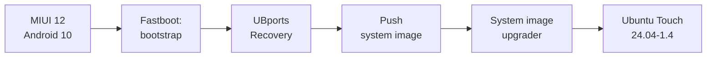

# Ubuntu Touch via Termux

**Flash Ubuntu Touch 24.04 ke Poco X3 NFC (`surya`) dari HP Android lain — tanpa PC.**


> [!WARNING]
> **Operasi ini menghapus seluruh data di HP target** (foto, aplikasi, akun, semuanya).
> Bootloader target harus **sudah unlocked**. Jangan pernah menjalankan
> `fastboot oem lock` setelah flashing. Baca seluruh panduan sebelum mulai.
> Risiko brick selalu ada, meskipun proses ini sudah diuji end-to-end.

> **English overview** — This repo documents a tested, PC-free flash of Ubuntu Touch
> 24.04-1.4 on a Poco X3 NFC (`surya`) using another rooted Android phone running
> Termux. The key trick is to run `adb`/`fastboot` as **root** so they can access
> `/dev/bus/usb` directly, instead of using `termux-usb`/`termux-adb` which hang on
> recent Android versions. The full step-by-step is in Indonesian below; all
> commands are copy-paste ready. See [docs/TROUBLESHOOTING.md](docs/TROUBLESHOOTING.md)
> for the pitfalls we hit.

---

## Daftar isi

- [Status teruji](#status-teruji)
- [Kenapa perlu root?](#kenapa-perlu-root)
- [Persyaratan](#persyaratan)
- [Struktur repo](#struktur-repo)
- [Checklist sebelum mulai](#checklist-sebelum-mulai)
- [0. Siapkan host Termux](#0-siapkan-host-termux)
- [1. Unduh bahan](#1-unduh-bahan)
- [2. Verifikasi checksum](#2-verifikasi-checksum)
- [3. Base firmware MIUI Android 10](#3-base-firmware-miui-android-10)
- [4. Flash bootstrap](#4-flash-bootstrap)
- [5. Masuk recovery dan cek /cache](#5-masuk-recovery-dan-cek-cache)
- [6. Push system image](#6-push-system-image)
- [7. Jalankan installer](#7-jalankan-installer)
- [8. First boot](#8-first-boot)
- [9. Verifikasi hasil](#9-verifikasi-hasil)
- [Troubleshooting](#troubleshooting)
- [Kembali ke Android](#kembali-ke-android)
- [Catatan keamanan](#catatan-keamanan)
- [Sumber dan kredit](#sumber-dan-kredit)
- [Lisensi](#lisensi)

---

## Status teruji

| | |
|---|---|
| Tanggal | 20 November 2026 |
| Host | Poco X6 Pro (`2311DRK48G`, `duchamp`), Android 17 (SDK 37), KernelSU, Termux 2.0.0-pre.5 (GitHub) |
| Tool host | `android-tools` 37.0.0p1 (`adb` + `fastboot`) |
| Target | Poco X3 NFC (`surya`), MIUI V12.0.9.0.QJGMIXM (Android 10) |
| Bootloader | Unlocked, ARB 2 |
| Hasil | Ubuntu 24.04.4 LTS Touch, build 5, tag **24.04-1.4**, kernel 4.14.221 |
| Rootfs | 4.9 GB (`/dev/mapper/system`), 2 GB bebas |
| Userdata | 103 GB, 98 GB bebas |
| Channel | `24.04-1.x/arm64/android9plus/stable` |

Alur besar:



---

## Kenapa perlu root?

UBports Installer resmi adalah aplikasi **Electron x86_64** — tidak ada build ARM64
untuk Termux. Alternatif tanpa root, `termux-adb` + `termux-usb`, bisa dicoba, tetapi
di Android baru sering **hang** karena layanan USB plugin dibatasi saat aplikasi
di background. Pada pengujian ini `termux-usb -l` tidak pernah mengembalikan output,
bahkan setelah `termux-api-start`.

Dengan **root** (KernelSU/Magisk), `adb` dan `fastboot` bisa membuka node
`/dev/bus/usb/...` langsung, sama seperti di PC. Tidak perlu Termux:API, tidak perlu
dialog izin USB. Ini jalur yang dipakai repo ini.

---

## Persyaratan

### Host (HP yang menjalankan Termux)

- Android + **Termux** (build GitHub atau F-Droid)
- **Root aktif** — KernelSU atau Magisk
- Paket: `android-tools` (adb + fastboot), `curl`
- Kabel USB **data** (bukan charge-only) + OTG
- Ruang kosong ±4 GB:
  - bootstrap 1,4 GB
  - system image 659 MB
  - MIUI zip 2,3 GB (opsional, hanya jika perlu flash ulang firmware)

### Target (Poco X3 NFC)

- Kode perangkat **`surya`** — bukan Poco X3 Pro (`vayu`), bukan Poco X3 India (`karna`)
- Bootloader **unlocked**
- MIUI **V12.0.9.0.QJGMIXM** (Android 10) sebagai base firmware
- TWRP (untuk flash zip MIUI bila firmware belum sesuai; instal lewat fastboot
  bila belum ada)
- USB debugging aktif
- Baterai target > 50%

> [!IMPORTANT]
> Base firmware yang diuji adalah MIUI Android 10 **V12.0.9.0.QJGMIXM**.
> Port Ubuntu Touch surya memang meminta firmware Android 10 terbaru. Jangan
> memakai firmware Android 11/12 sebagai base.

---

## Struktur repo

```
ubuntu-touch-via-termux/
├── README.md                     panduan utama (file ini)
├── LICENSE                       MIT
├── scripts/
│   ├── adb-r.sh                  wrapper adb sebagai root
│   ├── fastboot-r.sh             wrapper fastboot sebagai root
│   ├── unduh-bootstrap.sh        unduh recovery/dtbo/super/vendor
│   ├── unduh-system-image.sh     unduh UT 24.04-1.4 + generate ubuntu_command
│   ├── unduh-miui.sh             unduh Recovery ROM MIUI (opsional)
│   ├── verifikasi.sh             cek semua SHA-256 / MD5
│   ├── flash-bootstrap.sh        urutan fastboot (destruktif)
│   ├── push-system-image.sh      push ke /cache/recovery + verifikasi
│   └── pantau-instalasi.sh       pantau log upgrader
├── docs/
│   ├── TROUBLESHOOTING.md        masalah yang pernah muncul + solusinya
│   ├── TEKNIS.md                 detail partisi, mount, dan cara kerja upgrader
│   └── LOG-UJI.md                log end-to-end pengujian (disanitasi)
└── data/
    ├── SHA256SUMS.txt            semua checksum
    ├── MANIFEST.md               sumber, ukuran, metadata
    └── ubuntu_command-24.04-1.4  file perintah yang dibaca recovery
```

Repo **tidak menyimpan file binary besar**. Semua image diunduh dari sumber resmi
dan diverifikasi dengan checksum yang tercatat di `data/`.

---

## Checklist sebelum mulai

- [ ] `su -c id` → `uid=0(root)`
- [ ] `adb devices` → `device` (bukan `unauthorized`)
- [ ] `fastboot getvar product` → `surya`
- [ ] `fastboot getvar unlocked` → `yes`
- [ ] `fastboot getvar anti` → `2` (jangan lebih tinggi)
- [ ] Semua checksum valid (`scripts/verifikasi.sh`)
- [ ] Baterai host dan target > 50%
- [ ] Kabel USB data, bukan charge-only
- [ ] Sudah paham bahwa **semua data target akan hilang**

---

## 0. Siapkan host Termux

```bash
pkg update
pkg install android-tools curl
```

Pastikan root benar-benar aktif:

```bash
su -c id
# uid=0(root) gid=0(root) ... context=u:r:ksu:s0   (KernelSU)
# atau context=u:r:magisk:s0                        (Magisk)
```

Clone repo dan siapkan wrapper:

```bash
cd ~
git clone https://github.com/gilanx04/ubuntu-touch-via-termux.git
cd ubuntu-touch-via-termux
chmod +x scripts/*.sh

ADB="$PWD/scripts/adb-r.sh"
FB="$PWD/scripts/fastboot-r.sh"

su -c "$ADB start-server"
su -c "$ADB devices -l"
```

> [!TIP]
> `ADB` dan `FB` hanyalah variabel shell. Jika kamu membuka sesi Termux baru,
> set ulang dari root repo:
> ```bash
> cd ~/ubuntu-touch-via-termux
> ADB="$PWD/scripts/adb-r.sh"
> FB="$PWD/scripts/fastboot-r.sh"
> ```

Wrapper `adb-r.sh` melakukan tiga hal penting:

1. `TMPDIR=/data/local/tmp` — adb sebagai root butuh tmp yang bisa ditulis root.
2. `HOME=/data/data/com.termux/files/home` — kunci ADB ada di `~/.android` milik
   user Termux, bukan root. Jika home Termux-mu berbeda (profil kerja / user
   sekunder), set `TERMUX_HOME` sebelum memanggil wrapper.
3. Memakai path absolut ke `adb`/`fastboot` dari `$PREFIX/bin`, karena `su -c`
   biasanya me-reset `PATH`.

Contoh jika home Termux bukan default:

```bash
export TERMUX_HOME="$HOME"
su -c "TERMUX_HOME=$TERMUX_HOME $ADB devices"
```

### Otorisasi ADB

Saat pertama kali terhubung, target menampilkan:

> **Allow USB debugging?**
> RSA fingerprint: …

Centang **“Always allow from this computer”**, lalu **Allow**.

Cek:

```bash
su -c "$ADB devices -l"
# ABCD1234EF  device   usb:1-1 product:surya_global model:M2007J20CG device:surya
```

> [!NOTE]
> Nomor seri di atas hanya contoh. Jangan pernah mempublikasikan serial asli,
> IMEI, atau kunci ADB milikmu.

---

## 1. Unduh bahan

```bash
cd ~/ubuntu-touch-via-termux

bash scripts/unduh-bootstrap.sh       # 1,4 GB
bash scripts/unduh-system-image.sh    # 659 MB

# Opsional — hanya jika target perlu di-flash ulang ke MIUI Android 10:
bash scripts/unduh-miui.sh            # 2,3 GB
```

Ringkasan bahan:

| Bahan | Isi | Ukuran |
|---|---|---|
| `bootstrap/` | `recovery.img`, `dtbo.img`, `super.img`, `vendor.img` | ±1,4 GB |
| `system-image/24.04-1.4/` | rootfs, device, boot, keyring, version + `.asc` + GPG | ±659 MB |
| `miui/` (opsional) | Recovery ROM MIUI V12.0.9.0.QJGMIXM | ±2,3 GB |

Sumber:

- Bootstrap: <https://github.com/ubuntu-touch-surya/ubuntu-touch-surya/releases/tag/stable-repartition>
- System image: <https://system-image.ubports.com/24.04-1.x/arm64/android9plus/stable/surya/index.json>
- MIUI: lihat [`data/MANIFEST.md`](data/MANIFEST.md)

---

## 2. Verifikasi checksum

```bash
bash scripts/verifikasi.sh
```

Keluaran yang diharapkan:

```
...
HASIL: SEMUA VALID
```

Yang diverifikasi:

- 4 file bootstrap — SHA-256
- 5 image Ubuntu Touch — SHA-256
- `ubuntu_command` — SHA-256
- Keberadaan semua `.asc` dan file GPG
- MIUI zip — **MD5 resmi Xiaomi** (jika file ada; jika tidak, dilewati)

> [!NOTE]
> Xiaomi hanya menerbitkan **MD5** untuk Recovery ROM. SHA-256 MIUI di
> `data/SHA256SUMS.txt` adalah catatan integritas lokal, bukan pembanding resmi.
> Verifikasi tanda tangan GPG file Ubuntu Touch dilakukan oleh
> `system-image-upgrader` di recovery saat instalasi.

---

## 3. Base firmware MIUI Android 10

**Lewati langkah ini jika target sudah berjalan MIUI V12.0.9.0.QJGMIXM (Android 10).**

Jika belum, flash Recovery ROM MIUI lewat TWRP:

1. Salin zip ke **SD card / USB OTG** (disarankan) atau internal storage:
   ```bash
   su -c "$ADB push miui/miui_SURYAGlobal_V12.0.9.0.QJGMIXM_7f83537667_10.0.zip /sdcard/"
   ```
   Simpan di SD card/OTG agar zip tidak ikut terhapus saat installer MIUI
   memformat data.
2. Matikan target, boot TWRP: **Volume Up + Power**.
3. **Install** → pilih zip MIUI.
4. Matikan **“Zip signature verification”** — zip ini ditandatangani kunci Xiaomi,
   bukan test-key TWRP.
5. Swipe untuk flash, tunggu, lalu reboot ke sistem.
6. Selesaikan setup MIUI, aktifkan **Developer options** dan **USB debugging**.

> [!NOTE]
> Setelah flash MIUI, TWRP bisa tertimpa recovery stock. Tidak masalah — langkah
> berikutnya memang mem-flash UBports Recovery lewat fastboot.

Sebelum flash, cek anti-rollback di fastboot:

```bash
su -c "$FB getvar anti"
# anti: 2
```

> [!CAUTION]
> Jangan flash firmware dengan nilai ARB lebih tinggi dari perangkat. Untuk
> V12.0.9.0.QJGMIXM nilainya **2**. Jika `getvar anti` menunjukkan angka lebih
> besar, **stop** — flashing bisa brick.

Detail metadata ROM ada di [`data/MANIFEST.md`](data/MANIFEST.md).

---

## 4. Flash bootstrap

Target harus di **bootloader (fastboot)**, bukan fastbootd.

```bash
su -c "$ADB devices -l"          # pastikan target terdeteksi
su -c "$ADB reboot bootloader"
sleep 5
su -c "$FB devices"              # → <serial>  fastboot
```

Cek identitas dan ARB:

```bash
su -c "$FB getvar product"       # product: surya
su -c "$FB getvar unlocked"      # unlocked: yes
su -c "$FB getvar is-userspace"  # is-userspace: no
su -c "$FB getvar anti"          # anti: 2
```

Jalankan otomatis:

```bash
SAYA_SETUJU=1 bash scripts/flash-bootstrap.sh
```

Atau manual, per perintah:

```bash
su -c "$FB format cache"
su -c "$FB format:ext4 userdata"

su -c "$FB flash recovery $PWD/bootstrap/recovery.img"
su -c "$FB flash dtbo     $PWD/bootstrap/dtbo.img"

su -c "$FB reboot fastboot"
# tunggu 10–20 detik sampai fastbootd aktif
su -c "$FB devices"
su -c "$FB getvar is-userspace"  # harus: yes

su -c "$FB wipe-super $PWD/bootstrap/super.img"
su -c "$FB flash vendor $PWD/bootstrap/vendor.img"

su -c "$FB reboot recovery"
```

Yang perlu diketahui:

- `vendor.img` berukuran 1,3 GB — bagian paling lama (±40 detik di USB 2.0).
  **Jangan cabut kabel.**
- `wipe-super` biasanya mencetak peringatan
  `skip copying super image avb footer due to sparse image`. Itu **normal**.
- Setelah `reboot recovery`, target masuk ke **UBports Recovery**, bukan TWRP.

---

## 5. Masuk recovery dan cek /cache

Tunggu adb di recovery:

```bash
su -c "$ADB wait-for-device"
su -c "$ADB devices -l"                      # → recovery
su -c "$ADB shell getprop ro.ubuntu.recovery" # → true
```

Sekarang bagian paling penting — **pastikan `/cache` adalah userdata 103 GB**:

```bash
su -c "$ADB shell 'df -h /cache'"
# Filesystem       Size  Used Avail Use% Mounted on
# /dev/block/sda16 103G  2.0M  103G   1% /cache

su -c "$ADB shell 'stat -c \"%d %i %n\" /cache /data/cache'"
# 66304 4456449 /cache
# 66304 4456449 /data/cache
```

Kedua baris harus punya **device dan inode yang sama**.

> [!WARNING]
> **Jangan menjalankan `mount -a` di UBports Recovery.**
> Di perangkat ini `/cache` adalah bind-mount dari `/data/cache` (userdata).
> `mount -a` akan menumpuk partisi cache fisik yang hanya **344 MB** di atasnya.
> Akibatnya push 659 MB gagal dengan `No space left on device`, dan file yang
> sudah dipush bisa “hilang” di balik mount tersebut.

Jika `df -h /cache` menunjukkan **344M**, lepas mount cache yang menumpuk:

```bash
su -c "$ADB shell 'umount /cache'"
su -c "$ADB shell 'df -h /cache'"
# sekarang harus 103G
```

Cek juga bahwa `/cache` dan `/data/cache` masih inode yang sama setelah `umount`.

---

## 6. Push system image

Otomatis (sekaligus verifikasi SHA-256 di perangkat):

```bash
SAYA_SETUJU=1 bash scripts/push-system-image.sh
```

Manual:

```bash
cd system-image/24.04-1.4
su -c "cd $PWD && $ADB push ./*.tar.xz ./*.tar.xz.asc ubuntu_command /cache/recovery/"
su -c "$ADB shell sync"
```

Verifikasi di perangkat:

```bash
su -c "$ADB shell 'cd /cache/recovery && busybox sha256sum ./*.tar.xz'"
```

Bandingkan dengan [`data/SHA256SUMS.txt`](data/SHA256SUMS.txt). Script
`push-system-image.sh` melakukan perbandingan ini otomatis dan berhenti jika ada
perbedaan.

Isi `/cache/recovery` setelah push:

```
boot-....tar.xz        + .asc
device-....tar.xz      + .asc
keyring-....tar.xz     + .asc
rootfs-....tar.xz      + .asc
version-5.tar.xz       + .asc
image-master.tar.xz    + .asc
image-signing.tar.xz   + .asc
ubuntu_command
```

---

## 7. Jalankan installer

```bash
su -c "$ADB reboot recovery"
```

Recovery akan membaca `/cache/recovery/ubuntu_command` dan otomatis menjalankan
`/sbin/system-image-upgrader`. Di layar target muncul logo/progress UBports.

Pantau log:

```bash
bash scripts/pantau-instalasi.sh
```

Atau manual:

```bash
su -c "$ADB shell 'tail -f /cache/ubuntu_updater.log'"
```

Tunggu sampai muncul:

```
Done upgrading...
```

Arti baris yang sering muncul:

| Baris | Arti |
|---|---|
| `Keyring doesn't exist: device-signing` | Normal — upgrader memakai `image-signing` |
| `Invalid sparse file format at header magic` | Normal — boot di-flash raw, bukan sparse |
| `Failed to read sparse file` | Normal — lanjut ke fallback raw `dd` |
| `Formatting: data` | Userdata dihapus, **kecuali** `/data/cache` |
| `Applying update: rootfs-...` | Rootfs diekstrak ke partisi system |
| `Done upgrading...` | **Selesai** |

> [!IMPORTANT]
> `format data` menghapus kunci ADB di userdata. Setelah instalasi selesai,
> target bisa meminta **Allow USB debugging** lagi. Itu normal — tap Allow.

Setelah `Done upgrading...`, reboot ke sistem:

```bash
su -c "$ADB reboot"
```

Atau tap **Reboot** di layar recovery.

---

## 8. First boot

Boot pertama Ubuntu Touch bisa memakan **5–10 menit**. Jangan panik jika logo
Ubuntu tampil lama.

Selesaikan welcome wizard di layar target:

1. Pilih bahasa.
2. Pilih zona waktu.
3. Hubungkan Wi-Fi.
4. Buat passcode / PIN.
5. Selesai.

Jika macet di logo lebih dari 15 menit:

```bash
su -c "$ADB devices -l"
su -c "$ADB shell 'tail -50 /cache/ubuntu_updater.log'"   # hanya valid di recovery
```

---

## 9. Verifikasi hasil

```bash
su -c "$ADB shell 'system-image-cli -i'"
```

Contoh keluaran yang benar:

```
current build number: 5
device name: surya
channel: 24.04-1.x/arm64/android9plus/stable
version version: 5
version tag: 24.04-1.4
version rootfs: 2026-07-13T01:56:29Z_arm64_ubports/24.04-1.x_336_ee1a6261b7db2a262c137d81a40ee3323a0019d9
version device: 20260608-2438
version boot: 20260619-004143Z
```

Cek sistem:

```bash
su -c "$ADB shell 'cat /etc/os-release | head -5'"
su -c "$ADB shell 'uname -a'"
su -c "$ADB shell 'df -h / /android/data'"
```

> [!NOTE]
> Channel stable bisa menawarkan build lebih baru dari 1.4. Jika kamu ingin tetap
> di **24.04-1.4**, jangan terima OTA. Matikan auto-download di
> *Settings → Updates*.

---

## Troubleshooting

Ringkasan masalah yang paling sering muncul:

| Gejala | Penyebab | Solusi |
|---|---|---|
| `termux-usb -l` hang | Layanan USB plugin dibatasi background | Pakai root + `android-tools` (panduan ini) |
| `adb devices` kosong | Server adb bukan root / kabel charge-only | `su -c "$ADB kill-server"` lalu `start-server`; ganti kabel |
| `unauthorized` | Belum tap Allow | Tap **Allow** + **Always allow** di target |
| `fastboot` menunggu terus setelah `reboot fastboot` | fastbootd butuh 10–20 detik | Tunggu, cek `fastboot devices` berulang |
| Push gagal `No space left on device` | Partisi cache 344 MB menumpuk di `/cache` | `adb shell umount /cache`, cek `df -h /cache` = 103G |
| `/cache` hanya 344M | `mount -a` menumpuk partisi cache | `umount /cache`; **jangan** `mount -a` |
| `Failed to read sparse file` | Boot image bukan sparse | Normal, abaikan |
| `Keyring doesn't exist: device-signing` | Tidak ada keyring device | Normal, pakai `image-signing` |
| Installer terlihat diam | Log tidak ditampilkan ke layar | `tail -f /cache/ubuntu_updater.log` |
| Setelah install adb `unauthorized` | `format data` menghapus kunci ADB | Tap Allow lagi |
| `ro.ubuntu.recovery` kosong | Sedang boot sistem, bukan recovery | Cek `adb devices`; pastikan masuk recovery |
| TWRP menolak zip MIUI | Signature verification aktif | Matikan “Zip signature verification” |

Detail lengkap, termasuk log dan perintah diagnosa:
**[docs/TROUBLESHOOTING.md](docs/TROUBLESHOOTING.md)**

Penjelasan partisi, mount `/cache`, dan cara kerja upgrader:
**[docs/TEKNIS.md](docs/TEKNIS.md)**

Log lengkap pengujian (fastboot, recovery, upgrader, hasil akhir):
**[docs/LOG-UJI.md](docs/LOG-UJI.md)**

---

## Kembali ke Android

Setelah Ubuntu Touch, recovery yang terpasang adalah **UBports Recovery**, bukan
TWRP. Untuk kembali ke MIUI ada dua jalur.

### Opsi A — Fastboot ROM MIUI (paling bersih)

1. Unduh **fastboot ROM** MIUI V12.0.9.0.QJGMIXM untuk `surya` (file `.tgz`,
   bukan zip Recovery ROM).
2. Ekstrak di host.
3. Masuk fastboot, lalu jalankan `flash_all.sh` dari folder hasil ekstrak
   (pastikan `fastboot` dari Termux ada di `PATH`).
4. **Cek ARB** sebelum flash. Jangan flash ROM dengan ARB lebih tinggi.

### Opsi B — TWRP + Recovery ROM

1. Unduh TWRP untuk `surya`.
2. Flash TWRP lewat fastboot:
   ```bash
   su -c "$FB flash recovery twrp.img"
   ```
3. Boot TWRP (**Volume Up + Power**).
4. Flash zip MIUI Recovery ROM (matikan signature verification).
5. Reboot ke sistem.

> [!CAUTION]
> Jangan lock bootloader setelah kembali ke Android. Locking pada firmware yang
> tidak cocok bisa membuat perangkat tidak bisa boot.

---

## Catatan keamanan

- **Jangan commit** serial number, IMEI, SSID Wi-Fi, kunci ADB, atau token GitHub.
- Repo ini hanya berisi dokumentasi, script, dan checksum — **bukan binary**.
- Selalu verifikasi checksum sebelum flashing.
- Flash hanya firmware yang sesuai (`surya`, ARB 2).
- Simpan salinan log instalasi jika terjadi masalah.

---

## Sumber dan kredit

- **Port Ubuntu Touch surya** — <https://github.com/ubuntu-touch-surya/ubuntu-touch-surya>
- **UBports system-image** — <https://system-image.ubports.com/>
- **UBports Installer** — <https://github.com/ubports/ubports-installer>
- **Halium recovery / system-image-upgrader** — <https://github.com/ubports>
- **Termux** — <https://termux.dev/>
- **android-tools** — <https://github.com/termux/termux-packages>
- **MIUI Recovery ROM** — halaman resmi Xiaomi / XMFirmwareUpdater
- Terima kasih kepada maintainer port surya, UBports, dan komunitas Termux.

---

## Lisensi

[MIT](LICENSE) © 2026 Gilang Muttaqin
